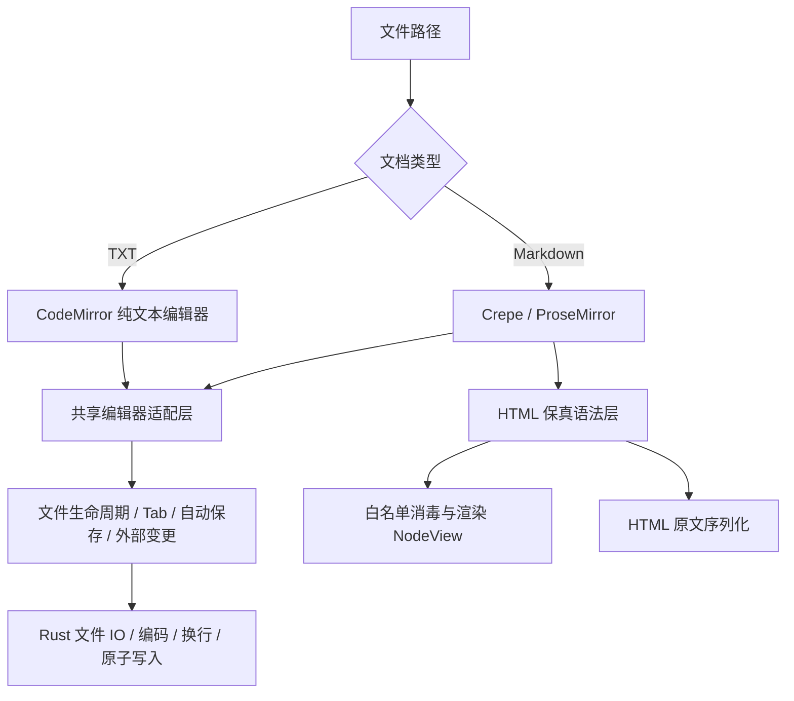

# Oblet v0.9.0 迭代技术设计：TXT 与 GitHub 风格 HTML

> 状态：实现完成，Windows 验收通过，Android 验收中
> 日期：2026-10-26  
> 基线：v0.8.0  
> 关联文档：《Oblet-技术设计文档》、`GLOSSARY.md`、ADR 0001、ADR 0002

## 1. 背景与目标

本迭代解决两个独立但共同触及“原文保真”的需求：

1. 支持 `.txt` 纯文本文件的打开、渲染与编辑，不主动新增系统文件关联。
2. 让包含常见原生 HTML 的 Markdown 在 Oblet 中获得接近 GitHub README 的可读渲染，首要实样为 `D:\个人文档\PROJECTS\ppt-master\README_CN.md`。

“GitHub 程度”在本迭代中的正式名称是 **GitHub README 安全渲染兼容**。它描述渲染能力，不表示完整复刻 GitHub 站点导航、全部私有渲染管线或任意 HTML 双向编辑。

### 1.1 必须达成

- TXT 使用真正的纯文本语义，打开、渲染、切换 Tab、保存均不经过 Markdown 解析器。
- TXT 与 Markdown 可在同一窗口混合使用 Tab，核心文件生命周期行为一致。
- Markdown 中的常见块级 HTML、行内 HTML、`details/summary` 及 details 内嵌 Markdown 可渲染。
- HTML 原文始终是文档事实源，保存不将渲染 DOM 或规范化 HTML 写回。
- HTML 渲染必须经过显式白名单消毒，主动内容和不安全 URL 不得进入 DOM。
- Windows 与 Android 均完成真实验收，现有序列化回归保持全部通过。

### 1.2 明确不做

- 不新增 `.log`、`.text` 或其他纯文本扩展名，不新建 TXT 文件。
- 不让 TXT 使用 Markdown 工具栏、斜杠菜单、TOC、Mermaid、图片操作或“保存至 Vault”。
- 不追求超大日志文件查看器能力，首版性能验收规模为 1MB TXT。
- 不新增 Windows TXT 文件关联，不修改 `register-md.bat`、TXT 图标或注册表逻辑。
- 不实现 HTML 内部 DOM 所见即所得编辑，不引入整篇文档的第二套编辑/预览引擎。
- 不执行 ` ```html ` 围栏内容；它仍是高亮代码块。
- 不支持脚本、iframe、表单、任意 SVG、内联样式或完整网页嵌入。
- 不保证所有本地资源链接的导航行为，不复制 GitHub Camo 图片代理。

## 2. 已确认产品决策

| 主题 | 决策 |
| --- | --- |
| TXT 编辑 | 独立 CodeMirror 纯文本编辑器，可编辑 |
| TXT 核心能力 | 打开、编辑、自动保存、Ctrl+S、混合 Tab、外部变更重载、重命名、Ctrl+F、PDF |
| TXT 编码 | UTF-8/UTF-8 BOM 可编辑；UTF-16 BOM 与可靠识别的 GBK 正确解码后只读 |
| TXT 文件关联 | 不主动新增；Windows 关联脚本不变，Android Intent Filter 保持现状 |
| HTML 渲染位置 | 当前 Oblet 文档视图，不增加整篇双模式 |
| HTML 编辑 | 渲染岛只读；块级源码可编辑，行内正文直接编辑，标签源码可单独编辑 |
| HTML 范围 | 实样中的块级与行内标签、details/summary、details 内 Markdown 纳入 v0.9.0 |
| HTML 链接 | HTTP/HTTPS 走系统浏览器，相对 `.md` 可打开为 Tab，其他本地资源链接不保证 |
| 发版 | 全部出口标准通过后统一升级 0.9.0 |

Android 现有 `text/plain` 与 `application/octet-stream` Intent Filter 是为兼容来源不明的 `.md` 而保留。部分文件管理器可能已将 Oblet 列为 TXT 的打开方式，这属于既有行为，不是本迭代新增关联。

## 3. 总体架构



核心约束：**编辑器适配层共享文件生命周期，但不共享文档语义。** Markdown 的 ProseMirror 位置、TXT 的 CodeMirror 字符偏移只在各自文档类型内保存和恢复，不互相解释。

## 4. TXT 技术设计

### 4.1 文件入口与类型识别

- 建立共享的支持扩展名判断，Markdown 保持 `md/markdown/mdown/mkd`，新增 `txt`，避免桌面 argv、拖放和文件对话框各自漂移。
- Rust `md_arg_from` 扩展为通用文档参数提取，首实例与单实例转发使用同一规则。
- 起始页文件对话框增加“文本文档”过滤器；空窗口和编辑态拖放均接受 `.txt`。
- `openPathInTab`、最近打开和 Android SAF 继续复用统一入口，按路径判定文档类型。
- `rename_file` 保留当前扩展名。TXT 不得因重命名变为 `.md`，Markdown 新建逻辑不变。

### 4.2 编辑器适配层

适配层至少提供以下语义：

- `getContent()` / `replaceContent()`：取得和替换原始文本，不在 TXT 路径调用 `getMarkdown()`。
- `setReadonly()`：同步只读状态。
- 读取与恢复选区、滚动位置：用于 Tab 缓存。
- 内容变更通知：接入同一 dirty、500ms 防抖与 Ctrl+S 状态机。
- 类型与能力查询：Markdown 专属命令只在 Markdown 活跃时生效。

`tabs.ts` 不再直接依赖 Crepe 的 `getMarkdown()`、`replaceAll()` 和 PM 选区 API，改为依赖适配层。路径仍是 Tab 缓存唯一键，所有旧路径状态保存必须先于 `updatePaths`。

### 4.3 CodeMirror 纯文本编辑器

- 复用现有 CodeMirror 6 依赖和 `--ob-*` 主题变量，不引入第二套 UI 风格。
- 文档值就是原始字符串；保留空格、Tab、空行、末尾换行和看似 Markdown 的字符。
- 开启软换行，不显示 Markdown 工具栏、块手柄、TOC 或 Crepe 占位 UI。
- Ctrl+F 使用 CodeMirror 检索能力；复制、剪切、粘贴、全选遵循纯文本语义。
- PDF 导出打印当前纯文本视图，保留换行与空白，不经过 Markdown 渲染。
- 只读文件同时由编辑器变更过滤与保存状态机双重阻断。

### 4.4 编码与换行

文件读取返回逻辑编码、BOM、只读状态和原因：

| 输入 | 行为 |
| --- | --- |
| UTF-8，无 BOM | 可编辑，保存保持无 BOM |
| UTF-8 BOM | 剥离 BOM 后编辑，保存恢复原 BOM |
| UTF-16 LE/BE BOM | 按 BOM 正确解码，只读，不写回 |
| 可靠识别的 GBK | 正确解码，只读并提示编码，不写回 |
| 无法可靠识别 | 只读或明确拒绝，禁止损失字符后静默展示为正常内容 |

编码探测是启发式能力，界面必须在非 UTF-8 场景明确只读原因，不能承诺所有无 BOM 文件都能绝对正确识别。写命令只接受本迭代声明为可编辑的编码，前端只读不能成为唯一防线。

CRLF/LF 继续沿用首个换行探测与原样恢复策略。TXT 内部统一 LF 仅供编辑，落盘恢复原换行；未编辑不写回，BOM 与末尾换行不得丢失。

## 5. HTML 技术设计

### 5.1 事实源与语法层

Milkdown 已把 CommonMark `html` mdast 节点保存为原始字符串，当前仅以 `textContent` 展示。v0.9.0 在此基础上增加三类保真结构：

1. **HTML 块节点**：承接完整块级 HTML，例如 `p/table/hr` 与独立图片。节点属性保存原文，NodeView 只负责渲染。
2. **HTML 行内标记**：将同一 phrasing 容器内配对的 `<a>…</a>`、`<strong>…</strong>` 等转换为带原始开闭标签的标记。正文仍是正常可编辑内容，序列化时恢复原开闭标签。
3. **HTML details 容器**：配对根级 `<details>` 与 `</details>`，保存摘要及开闭原文，中间子节点继续按 Markdown 解析和编辑。

自定义 mdast 类型必须配有序列化 handler。details 需保存内容与开闭标签之间的原始空白，避免包装容器后擅增删空行。不能配对的标签、无法安全解析的结构和不支持的容器保持源码降级，不做浏览器式纠错后写回。

### 5.2 渲染与源码编辑

- 块级 HTML 使用 NodeView 渲染岛，提供源码查看/编辑入口；提交通过单个 PM 事务更新原文属性，可撤销。
- 行内 HTML 正文直接编辑；开闭标签与属性经源码入口修改，不将 DOM 属性序列化回文档。
- details 使用原生 `<details>` 交互，展开状态只是视图状态，不修改源码中的 `open` 属性。
- 源码浮层遵守现有 Enter/失焦提交、Esc 取消、单事务更新与 Android 返回键 `preventDefault` 规则。
- 外部变更、Tab 切换和主题切换只重渲染视图，不改写 HTML 原文。

### 5.3 消毒白名单

采用 DOMPurify 加显式白名单，不能以“本地文件可信”为理由直接 `innerHTML`。白名单参考 GitHub 公开的 HTML Pipeline 思路，但按 Oblet 威胁模型收紧。

允许常见只读排版元素：标题、段落、换行、强调、链接、图片、列表、表格、引用、定义列表、`kbd/q/samp/var/ruby`、`<details>` 与 `<summary>` 等。允许必要的呈现属性，如 `align/width/height/colspan/rowspan/open/alt/title`。

默认拒绝：

- `script/iframe/object/embed/form/input/button/link/meta/base/style`。
- 任意 `on*` 事件属性、`srcdoc`、内联 `style`。
- `javascript:`、`vbscript:`、危险 `data:`、协议相对或来源不明的外部协议。
- 任意 SVG/MathML 主动内容和未知标签。

`class/id/target` 不直接进入文档 DOM；链接行为由 Oblet 统一绑定，外链追加安全的 `rel`。渲染 DOM 中不执行脚本，也不能通过 HTML 获得 Tauri IPC 能力。

### 5.4 图片与链接

- 渲染后的 `img[src]` 逐个经过现有 `toDomUrl` 与 `resolveLocalAbs`，相对路径以当前文档目录为基准。
- 远程图片行为与 Markdown 图片一致；本期不增加代理或隐私缓存。
- HTTP/HTTPS 链接调用系统浏览器，正文普通编辑点击与 HTML 渲染岛链接点击必须明确区分。
- 相对 `.md` 链接经统一 `openPathInTab`，路径规范化后去重。
- 其他本地资源、锚点和 `mailto:` 不作为 v0.9.0 验收承诺；不允许因此放开未知协议。

### 5.5 样式与打印

- HTML 内容限定在 `.ob-html-*` 作用域，表格、图片、代码和排版消费 `--ob-*` 变量。
- 局部覆盖 ProseMirror 全局表格规则，防止 HTML 表格列重叠；图片保留 `width/height` 且不得超过可用宽度。
- 深色、浅色和六款主题不得出现不可读默认色。
- 打印前确保异步图片和代码块就绪；折叠内容的打印策略保持一致，不把源码浮层或编辑按钮打印出来。

## 6. 安全模型

威胁输入包括下载的 README、不可信仓库文档和带恶意 HTML 的本地文件。主要防线：

1. Markdown 原文与渲染 DOM 分离，渲染只做单向投影。
2. DOMPurify 白名单加 URL 协议校验，拒绝主动内容。
3. 本地路径只经既有 asset 转换与文档目录解析，不把任意 HTML 属性直接交给 Tauri。
4. 导航只走明确注册的动作，未知协议静默阻断或提示。
5. 源码编辑只更新原文属性，不执行提交内容。
6. XSS 测试同时断言“没有执行”和“没有危险 DOM”，不能只看页面未崩溃。

## 7. 测试与验收

### 7.1 TXT

- 文件对话框、拖放、命令行、单实例、最近打开、Android SAF 均可打开 `.txt`。
- `#`、列表符、HTML、前后空格、Tab、连续空行、末尾换行往返不变。
- UTF-8 BOM、CRLF/LF、未编辑不写回、自动保存、手动保存、外部变更均通过。
- Markdown → TXT → Markdown 混合切换后，内容、dirty、选区、滚动和只读状态不串档。
- TXT 重命名保持扩展名，Markdown 命令在 TXT 活跃时无效。
- UTF-16/GBK 样本不乱写回，只读提示准确。

### 7.2 HTML

- `README_CN.md` 中目标 `p/table/img/hr`、行内链接与图片、details/summary 和 details 内 Markdown 正确渲染。
- 本地相对图片可显示，HTTP/HTTPS 与相对 `.md` 链接走规定路径。
- 块级源码编辑、行内正文编辑、details 展开收起均可撤销或不污染原文。
- HTML 区域保存前后保持原文，未编辑文件不写回；现有 break/list 序列化回归全部 PASS。
- 覆盖嵌套与未配对标签、CRLF、空 details、同段多个行内标签、源码中的 Markdown。
- `script`、`onerror`、`javascript:`、iframe、表单、style、SVG 等恶意用例无危险 DOM、无执行、无导航。

### 7.3 构建与双端

- `npm run build`、`cargo check` 通过。
- Windows 真实 WebView2 CDP 验收与截图通过。
- Android 模拟器实测打开、编辑、返回键、链接、图片与混合 Tab，按项目约定检查权限。
- 全部出口满足后才修改五处版本号、更新 CHANGELOG 并准备 v0.9.0 tag。

## 8. 实施拆分

1. 文档与 ADR 落盘。
2. Rust 文件层：扩展名、编码元数据、重命名保扩展名。
3. TXT 纯文本组件与共享编辑器适配层。
4. HTML 保真语法层、消毒渲染、源码编辑和链接图片。
5. `setup.ts` / `tabs.ts` / 命令与菜单集成。
6. 单元与序列化回归、真实 README、Windows/Android 验收。
7. 版本升级与发布准备。

实施顺序可按文件所有权并行，但最终保真与双端验收只能在集成完成后进行。

## 9. 实现记录（2026-10-26）

### 9.1 已落地结构

- `adapter.ts`：文档类型、IO 元数据与 `EditorAdapter`；`markdown-adapter.ts` 封装 PM，`plaintext.ts` 提供 CM 纯文本实现。
- `text_encoding.rs`：UTF-8/BOM、UTF-16 BOM、GBK/GB18030 与 unknown 解码；`commands.rs` 统一编码元数据、BOM 写回和重命名保扩展名。
- `html.ts`：`html_block`、`html_details`、`html_inline_atom` 与按 HTML 嵌套深度、Markdown phrasing 边界分层的 inline marks，避免 PM mark 固定排序改写原文嵌套次序。
- details 保存摘要、开闭标签、子节点间隔与 body/close 空白；HTML 与 Markdown 混嵌均只序列化原文，不读取渲染 DOM 回写。
- `setup.ts` 同时装配两个编辑器，按活动路径切换显隐、命令和 Ctrl+F；Tab 切换先用旧路径保存，丢弃时恢复磁盘基线。
- Android `ObletNative.printDocument` 使用系统 `PrintManager`，桌面继续使用 `window.print()`。

### 9.2 已执行验证

| 验证 | 结果 |
| --- | --- |
| `node scripts/test-plaintext.mjs` | 10/10 PASS |
| `node scripts/test-html.mjs` | 21/21 PASS，含混嵌保真和真实 README 二轮稳定 |
| `node scripts/test-break-roundtrip.mjs` | 全部 PASS |
| `node scripts/test-list-roundtrip.mjs` | 全部 PASS |
| `cargo test` | 9/9 PASS |
| `npm run build` / `cargo check` | 通过 |
| `node scripts/repro-v090.mjs` | 29/29 PASS，真实 WebView2 全流程 |
| README 视觉检查 | `scripts/.repro/v090/readme.png`，表格、图片、details 与行内链接可读 |

Windows release 的 `oblet.exe` 构建成功；MSI 阶段仍为项目已知的 `light.exe` 失败，不影响本次 CDP 所用 exe。真实验收覆盖 BOM/CRLF、自动保存、外部重载、混合 Tab、TXT 重命名、UTF-16 只读、HTML 全文往返、源码编辑、XSS 和实样零写回。

### 9.3 待完成

- Android APK 构建、模拟器安装、权限、TXT/HTML、返回键与系统打印验证。
- Android 结果确认后更新版本号、CHANGELOG、README 与发版审计。
